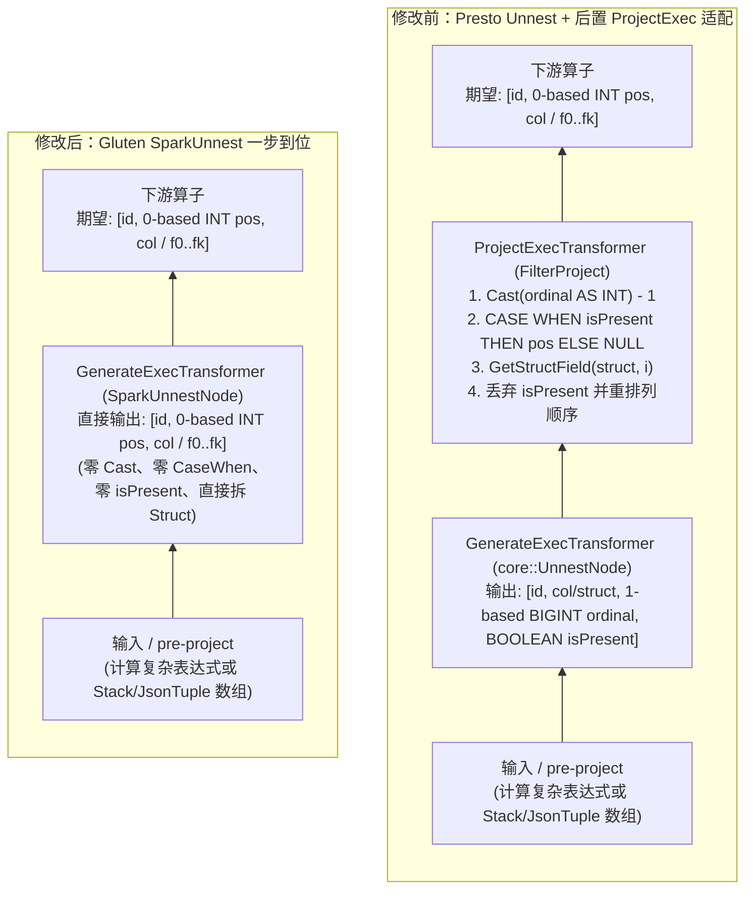
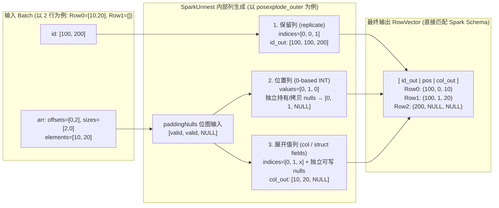
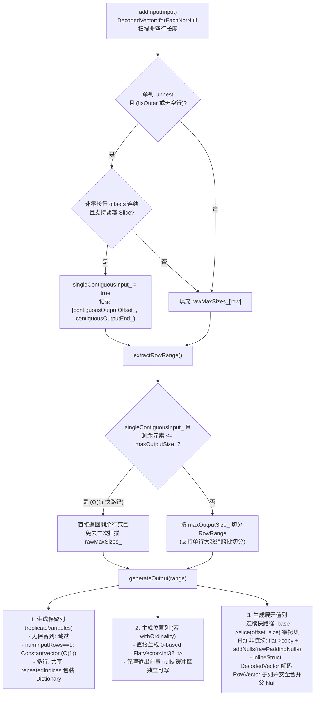

# SparkUnnest 算子设计文档

## 1. 背景与痛点

当前 Gluten 将 Spark 的 `GenerateExec`（`explode`、`posexplode`、`inline`、`stack`、`json_tuple` 及 `_outer` 变体）翻译为 Velox 的 Presto `core::UnnestNode` / `exec::Unnest`。由于 **Presto `UNNEST` 与 Spark `Generate` 存在 4 处核心语义错位**，Gluten 被迫在 `Unnest` 之后强行插入一层 `post-project`（`ProjectExecTransformer`）做适配：

| 维度 | Spark `GenerateExec` 语义 | Velox Presto `Unnest` 语义 | 现有 `post-project` 被迫做的额外工作 |
| --- | --- | --- | --- |
| **1. `pos` 列类型与起点** | `INTEGER`（32位），从 **0** 开始 | `BIGINT`（64位），从 **1** 开始 | 每行计算 `Cast(ordinal AS INT) - 1` |
| **2. `pos` 列顺序** | **`[id, pos, col]`**（`pos` 在值列前） | **`[id, col, ordinal]`**（`ordinal` 在值列后） | 额外走一趟 `FilterProject` 调换列顺序 |
| **3. `outer` 补齐行语义** | 空/NULL 集合直接输出 `pos = NULL, col = NULL`，无多余列 | `ordinal` 填数字 `0`，并在末尾多吐一列 `BOOLEAN` 标记 `isPresent` | 用 `CASE WHEN isPresent THEN pos ELSE NULL` 把 `0` 转成 `NULL`，再通过投影裁剪掉 `isPresent` |
| **4. `inline` 结构体展开** | `ARRAY<STRUCT<a, b>>` 直接输出拆开的 `[a, b]` 多列 | 只展开外层数组，输出单列 `STRUCT<a, b>` | 在 `post-project` 中对每个字段执行 `GetStructField` |

同时，Velox 原生 `exec::Unnest` 自身存在 3 个性能瓶颈：
1. **单列与多列 Zip 未分离**：Spark 除 `stack` 外全部是单列展开，但 Velox 总是走多列 `rawMaxSizes_` 扫描；
2. **连续性判断过于脆弱**：原版只要遇到跨输出 batch（`index != offset`）或夹杂空数组 `[]`，就放弃零拷贝 `slice`，退化为分配 `indices` + 包装 `Dictionary` + 整列 `BaseVector::copy`；
3. **不支持直接消费 Flat 映射与小字典**：非连续行走 `wrapInDictionary` 后逐行调虚函数拷贝。

---

## 2. 开源引擎设计借鉴（Doris / StarRocks / DuckDB / ClickHouse）

1. **StarRocks（`unnest.h` vs `multi_unnest.h`）**：
   - 将**单列 `Unnest`** 与**多列 `MultiUnnest`（对应 `stack`）**物理分离；
   - 单列非空连续元素直接零拷贝引用底层 `elements`；列裁剪时若不读值列（如只读 `id` 或 `pos`），直接跳过值列物化。
2. **Doris（`table_function_operator.cpp` 快路径）**：
   - 利用 Array 底层 `offsets` 单调非递减性质：**即使中间跳过 `outer=false` 的空/NULL 数组行（长度为 0），底层 `elements` 依然是连续的**；
   - 将 0-based `int32_t` 的 `posexplode` 直接内嵌在快路径中生成，不经过二次投影。
3. **ClickHouse（`ArrayJoinAction.cpp`）**：
   - 按 `maxOutputSize` 直接计算输入行窗口，对连续窗口直接 `slice(sourceStart, wrapSize)` 拿底层数据指针；
   - 对 `Map` 直接视作 `(keyElements, valueElements)` 双子列同步切片。
4. **DuckDB（`physical_unnest.cpp`）**：
   - 当一个输出 batch 全部来自同一行输入（大数组跨批切分）时，外层保留列直接包成 `ConstantVector`（O(1)，无需构造 `indices` 数组）；
   - 小字典或紧凑切片直接引用，仅在存在补空行时才按需物化或合并 Null 位图。

---

## 3. 总体架构设计

### 3.1 放置位置（Gluten 侧实现，零 Velox 接口侵入）
在 Gluten 仓库 `cpp/velox/operators/plannodes/` 下新增：
- `SparkUnnestNode`（继承 `facebook::velox::core::PlanNode`）
- `SparkUnnest`（继承 `facebook::velox::exec::Operator`）
- `SparkUnnestTranslator`（继承 `facebook::velox::exec::Operator::PlanNodeTranslator`）

在 `VeloxBackend::init`（及 `VeloxPlanEvaluator`）中通过 `facebook::velox::exec::Operator::registerOperator` 注册，**对 Velox 仓库的 `core::UnnestNode` 零修改**。

### 3.2 计划改写对比（彻底消除 `post-project`）



**`PullOutGenerateProjectHelper.pullOutPostProject` 直接简化为恒等返回 `generate`**！所有 5 种 Generator（`Explode`、`PosExplode`、`Inline`、`JsonTupleExplode`、`Stack`）无论 `inner` 还是 `outer`，均无需任何 `post-project`。

---

## 4. `SparkUnnestNode` 与 `SparkUnnest` 详细设计

### 4.1 `SparkUnnestNode` 定义与输出列顺序

```cpp
class SparkUnnestNode final : public facebook::velox::core::PlanNode {
 public:
  SparkUnnestNode(
      const facebook::velox::core::PlanNodeId& id,
      std::vector<facebook::velox::core::FieldAccessTypedExprPtr> replicateVariables,
      std::vector<facebook::velox::core::FieldAccessTypedExprPtr> unnestVariables,
      bool withOrdinality,   // PosExplode: 0-based INTEGER, 位于展开值列之前
      bool isOuter,          // *_outer: 空/NULL 集合补 1 行 NULL，不输出 marker 列
      bool inlineStruct,     // Inline / JsonTupleExplode: 直接拆解 ARRAY<ROW<...>> 的子列
      facebook::velox::RowTypePtr outputType,
      facebook::velox::core::PlanNodePtr source);
};
```

**输出列布局与 `outputType` 推导规则（无需扩展 `GenerateRel` Protobuf，直接由 `SubstraitToVeloxPlan::toVeloxPlan(const ::substrait::GenerateRel&)` 构造对齐 Spark `GenerateExec.output`）**：
1. **`replicateVariables`**：原表保留列（如 `id`），来自 `GenerateRel.child_output()`；
2. **可选 `pos` 列（当 `withOrdinality == true`，即 `isPosExplode=1`）**：紧跟在保留列之后、展开值列**之前**，固定类型 `INTEGER()`（0-based；`isOuter` 空行时为 `NULL`）；
3. **展开值列**：
   - `ARRAY<T>`（`inlineStruct == false`）：1 列 `T`；
   - `MAP<K, V>`：2 列 `K, V`；
   - `ARRAY<ROW<f0, f1, ...>>`（`inlineStruct == true`，即 `isInline=1`，涵盖 `Inline` 与 `JsonTupleExplode`）：直接拆为 `k` 列 `f0, f1, ...`（若为 0 字段 `ROW<>`，则产生 0 列值输出，但仍保留数组元素对应的输出行数以驱动保留列/`pos` 列）；
   - 多列 `ARRAY<T_i>`（`isStack=1`）：`m` 列 `T_0, ..., T_{m-1}`。
4. **无 `isPresent` 标记列**。



### 4.2 核心执行路径设计



#### 路径 1：单列 `inner` 连续快路径（覆盖 `explode`、`posexplode`、`inline` 非 outer）
1. **`addInput` 阶段**：
   - 使用 `DecodedVector::forEachNotNull` 扫描非空集合行，填充 `rawMaxSizes_[row] = size`；
   - 同时检查非空、非零长行的 `offsets[index]` 是否首尾相接（注意：**长度为 0 的空数组行或 `NULL` 数组行在 `inner` 模式下产生 0 行输出，不破坏底层 `elements` 连续性！**）；
   - 若连续，设置 `singleContiguousInput_ = true`，记录起始偏移 `contiguousOutputOffset_` 与结束偏移 `contiguousOutputEnd_`。
2. **`extractRowRange` 阶段**：
   - 若 `singleContiguousInput_` 且剩余元素数 `contiguousOutputEnd_ - contiguousOutputOffset_ <= maxOutputSize_`，**O(1) 直接返回剩余行范围**，无需二次扫描 `rawMaxSizes_`！
3. **`generateOutput` 阶段（零索引分配）**：
   - 对 `Array` / `Map` 的底层 `elements`（或 `mapKeys` / `mapValues`）：直接调用 `base->slice(contiguousOutputOffset_, numInnerRows)`（**零拷贝**）；
   - 若 `inlineStruct == true`：
     - 先通过 `DecodedVector` 解码 `ArrayVector::elements()`（处理底层 `RowVector` 可能被 Dictionary/Constant 包装的情形）；
     - 若底层为平坦 `RowVector` 且满足连续切片条件，先执行 `slice(contiguousOutputOffset_, numInnerRows)`；
     - 对每个子列 `child_i`：若父 `RowVector` 存在 NULL（例如 `ARRAY<STRUCT>` 中含有 `NULL` 结构体元素），**禁止对可能共享或 Constant/Dictionary 编码的 `childAt(i)` 原地调用 `BaseVector::addNulls`**（因为 `BaseVector::addNulls` 强制要求 `VELOX_CHECK(isNullsWritable())`），必须通过新分配的独占 Null 缓冲区包装 Dictionary 或拷贝物化后再合并父级结构体 NULL 位图；
     - 若为 0 字段 `ROW<>`，不产生展开值列，但仍按数组元素基数生成保留列与 `pos` 列。

#### 路径 2：单列 `outer` 快路径（覆盖 `explode_outer`、`posexplode_outer`、`inline_outer`、`json_tuple`）
1. **当本批次不存在空/NULL 集合行（`!range.hasEmptyUnnestValue`）**：
   - 完全退化并复用**路径 1**！
2. **当本批次存在空/NULL 集合行（`range.hasEmptyUnnestValue`）**：
   - 单次遍历 `range.forEachRow` 同时生成 `indices`（指向底层 `elements`）与 `paddingNulls`（仅在补齐行置 `null`）：
     - 若 `size == 0`：`bits::setNull(rawPaddingNulls, outIdx++, true)`；
     - 若 `size > 0`：`std::iota(rawIndices + outIdx, rawIndices + outIdx + size, offsets[inputIndices[row]] + start)`；
   - **Null 缓冲区所有权与可写性约束**：
     - `BaseVector::addNulls` 在执行 copy-on-write 之前会先检查 `VELOX_CHECK(isNullsWritable())`（要求 `nulls_->unique()`），因此**禁止让两个输出列（如 `pos` 与 Dictionary 包装的值列）通过 `setNulls` 共享同一个 `paddingNulls` `BufferPtr`**；
     - 若值列走 `FlatVector` 拷贝路径（`flat->copy(base, rows, rawIndices)` + `flat->addNulls(rawPaddingNulls)`），`flat` 仅读取 `rawPaddingNulls` 并写入自身独立的 `nulls_` 缓冲区，此时 `paddingNulls` 引用计数仍为 1，可安全移交给 `pos` 列（`ordinalityVector->setNulls(paddingNulls)`）；
     - 若值列（或 `inlineStruct` 多子列）自身需持有 `paddingNulls`，则为需要独立持有或继续合并父级 NULL 的列分配/克隆独立的 Null 缓冲区。

#### 路径 3：外层保留列（`replicateVariables`）生成
- 若当前查询无保留列（`identityProjections_.empty()`）：直接跳过；
- 若当前输出批次全部来自**同一个输入行**（`range.numInputRows == 1`，超大数组跨批场景，借鉴 DuckDB）：
  - 直接使用 `BaseVector::wrapInConstant(numInnerRows, range.startInputRow, input_->childAt(channel))`，免去分配和填充 `repeatedIndices`；
- 常规多行场景：填充一次 `repeatedIndices`，各保留列共享同一个 `repeatedIndices` Buffer 包装 `wrapInDictionary`。

#### 路径 4：多列 Zip 路径（仅 `Stack` 使用）
- 保持多列 `rawMaxSizes_[row] = max(size_col)` 语义，使用 `forEachNotNull` 扫描，并在 `outer` 模式下直接将空行补为 `NULL`，无需吐出 `isPresent` 列。

---

## 5. 涉及修改的文件清单

| 模块 | 文件 | 改动说明 |
| --- | --- | --- |
| **Scala 计划改写** | `backends-velox/.../GenerateExecTransformer.scala` | 1. `pullOutPostProject` 不再为 `PosExplode / Inline / JsonTupleExplode / Explode / Stack` 插入后置 `ProjectExec`；<br>2. `getExtensionNode` 增加 `isInline = generator.isInstanceOf[Inline] \|\| generator.isInstanceOf[JsonTupleExplode]`（`1/0`）区分结构体拆列与普通 `Explode(ARRAY<STRUCT>)`。 |
| **Native 算子** | `cpp/velox/operators/plannodes/SparkUnnest.h`<br>`cpp/velox/operators/plannodes/SparkUnnest.cc` | 新增 `SparkUnnestNode`、`SparkUnnest`、`SparkUnnestTranslator`，实现上述 4 条路径。 |
| **Substrait 转计划** | `cpp/velox/substrait/SubstraitToVeloxPlan.cc`<br>`cpp/velox/substrait/SubstraitToVeloxPlanValidator.cc` | `toVeloxPlan(const ::substrait::GenerateRel& generateRel)` 改为构造 `SparkUnnestNode`（`ExpandRel` 原有逻辑保持不动），并根据 `replicateVariables + isPosExplode + isInline + unnestVariables` 精确构造 `outputType`。 |
| **算子注册与 Benchmark** | `cpp/velox/compute/VeloxBackend.cc`<br>`cpp/velox/compute/VeloxPlanEvaluator.cc` | 1. `VeloxBackend` 注册 `SparkUnnestTranslator`；<br>2. `VeloxPlanEvaluator` 舞台白名单加入 `SparkUnnestNode`，并将 `UnnestOutput` 泛化为同时驱动 `SparkUnnest` 与 `exec::Unnest`（不再硬编码 `dynamic_cast<exec::Unnest*>`）。 |
| **表达式内部优化（Velox）** | `SwitchExpr.cpp` / `ArrayConstructor.cpp` / `Arithmetic.h` / `RegisterMath.cpp` | 均不涉及任何算子接口修改，保留在 Velox 侧以加速 `pre-project` 中的 `% 3`、`IF` 和 `array(...)` 构造。 |

---

## 6. 预期收益与验证标准

1. **架构收益**：
   - Velox 的 `core::UnnestNode`、`PlanNodeSerde`、`TraceUtil` 保持 100% 原生上游代码，零接口冲突；
   - Gluten 物理计划中所有 Generator 算例消除后置 `ProjectExecTransformer`（`FilterProject`）算子。
2. **性能预期**：
   - 所有 `stored-*` 算例直接达到最优（`1.3x ~ 4.0x` 超越 JVM）；
   - `posexplode_outer/stored-mixed` 等不再经过 `Cast(BIGINT -> INT) - 1` 和 `CaseWhen` 后置投影，比之前 `S4`（19 ms）进一步下降至 `~15 ms`；
   - 配合 Velox 表达式内部优化后，6 个 `array-mixed / struct-array-mixed` 达到 `18~28 ms`（较无优化基线 `70~107 ms` 提升 **2.8x ~ 3.8x**）。
3. **验证范围**：
   - `CatalogSuite`、`RunnerSuite`、`BenchmarkSuite`、`ExpressionEvaluatorSuite`（354 个测试，覆盖 `VeloxPlanEvaluator` 中的 `SparkUnnestNode` 阶段）全过；
   - `GlutenGeneratorFunctionSuite`、`GlutenDataFrameFunctionsSuite` 全过；
   - 定向回归覆盖：Dictionary/Constant 编码的 `ARRAY<ROW>` inline、含 NULL 结构体元素与含 NULL 子字段、0 字段 `ROW<>`、上层 `ProjectExec` 裁剪 `pos` 或部分字段、`posexplode_outer` 空/NULL 补齐、`json_tuple` 多字段与重复/缺失字段；
   - `generator.json` 单进程 22 个算例无 profiler 正式测量对比。
